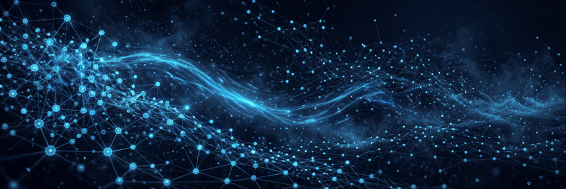

  

  

### Machine Learning Engineer — I build ML and LLM systems that run in production, and hold them to the numbers.

- 🔭 Flagship build: **[QuizMark](https://github.com/ankurxbatta/QuizMark)** — a RAG auto-marking platform that ran a real graded quiz for **~150 students** on **~$22** of model spend, agreeing with the instructor's independent grading at **r = 0.80**
- 🎓 Post-Degree Diploma in Data Analytics, Langara College — **4.11 CGPA**, graduated with distinction · B.Tech Computer Science & Engineering, Punjab Technical University
- 📍 Vancouver, BC — open to Machine Learning Engineer roles · Eligible to work in Canada (Open Work Permit)

## 🛠️ Technical Skills

  
  
  
  
  
  
  
  
  
  
  
  
  
  

**ML & Modelling** — scikit-learn, CatBoost, XGBoost, TensorFlow/Keras, Hugging Face Transformers (BERT fine-tuning), Deep Learning, NLP
**LLMs & Retrieval** — RAG, embeddings & vector search, Reciprocal Rank Fusion, hybrid reranking, LangChain, Model Context Protocol (MCP), tool calling, LLM cost optimization · OpenAI, Anthropic, Gemini APIs
**Evaluation** — Recall@k, MRR, nDCG@k, ROC/PR AUC, calibration & Brier scores, stratified k-fold CV, class imbalance
**MLOps & Cloud** — AWS (EC2, S3, SageMaker), Docker, Kubernetes, MLflow, FastAPI, Celery/Redis, GitHub Actions CI, pytest, Linux
**Languages & Data** — Python, SQL, R, TypeScript, C++ · pandas, NumPy, MongoDB Atlas Vector Search, PostgreSQL

  <picture>
    <source media="(prefers-color-scheme: dark)" srcset="https://raw.githubusercontent.com/ankurxbatta/ankurxbatta/output/github-snake-dark.svg" />
    <source media="(prefers-color-scheme: light)" srcset="https://raw.githubusercontent.com/ankurxbatta/ankurxbatta/output/github-snake.svg" />
    
  </picture>

## 🔥 More than models

- 👾 Always up for a hackathon — that's where EventOps AI (Web Summit Vancouver) and the rescue drone swarm (StormHacks 2026) were born
- 🌍 I build things that matter, and I make sure I live life too — not a nerd, just awesome
- 🧠 *"The best way to predict the future is to invent it."*

## 🌐 Connect with me

- 💼 [linkedin.com/in/ankurbatta](https://www.linkedin.com/in/ankurbatta)
- 🌐 [iankurbatta.web.app](https://iankurbatta.web.app)
- 📧 ankurbatta.30@gmail.com
